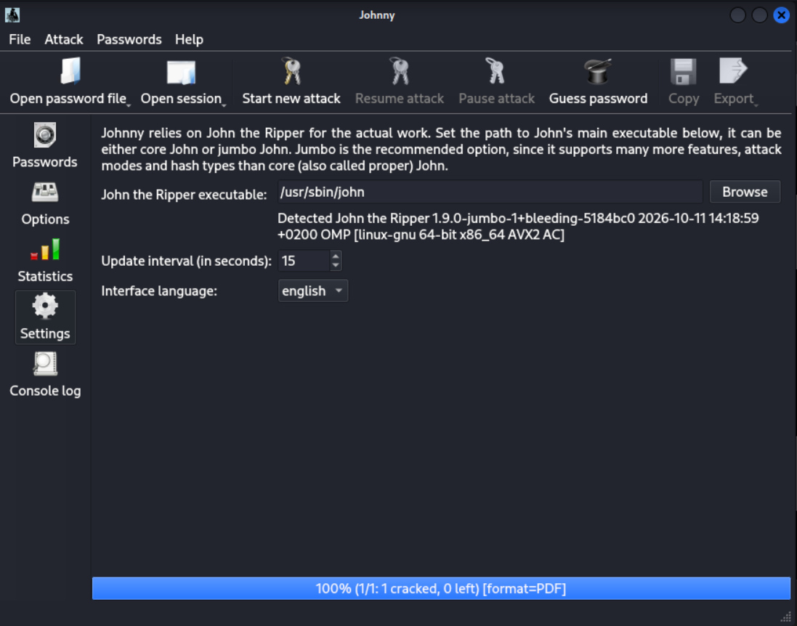
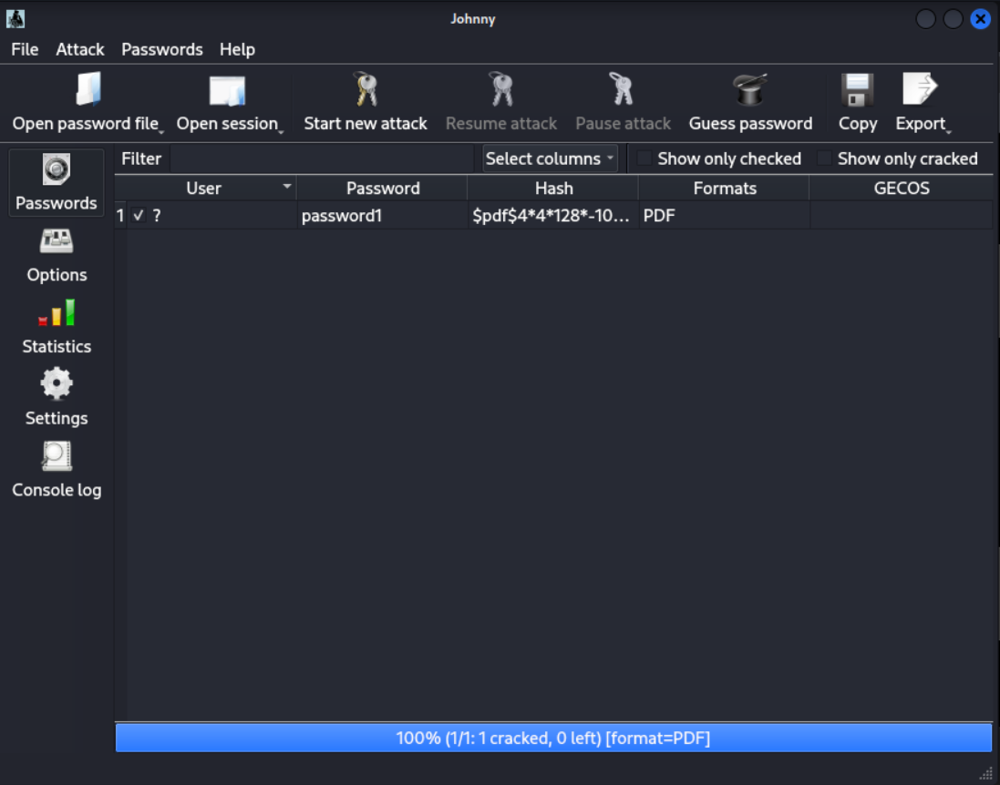
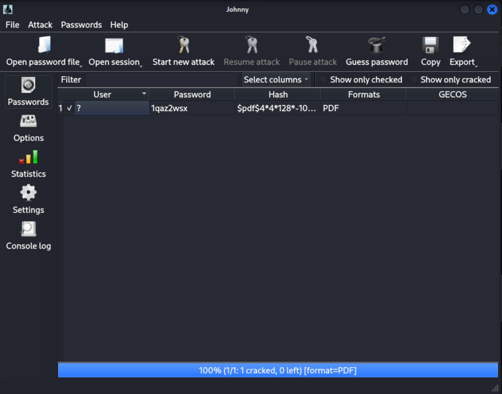
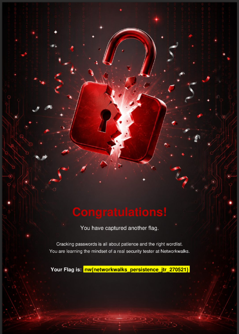
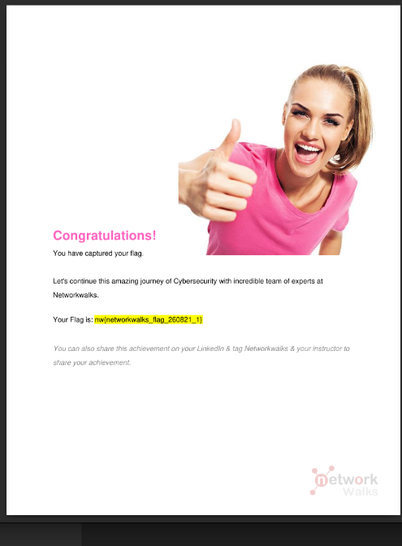

# Week 3 – Module 1: Password Cracking with JTR (John the Ripper)

**Internship:** NetworkWalks-Cybersecurity
**Intern:** [Awais Sajjad]
**Week:** 3

> Performed for educational purposes only, on password-protected PDF
> files provided for this lab exercise.

## Background
John the Ripper (JTR) is a widely used password cracking/auditing tool
that supports many hash types and can recover passwords from protected
files like PDF, ZIP, and Office documents. Johnny is its graphical
front-end, making it accessible without needing to memorize command-line
syntax.

## Objective
Crack the passwords of the provided protected PDF files using JTR's
**Johnny** GUI.

## Environment Used
Kali Linux — John the Ripper comes pre-installed, so Johnny (the GUI)
was installed separately and pointed to the existing John binary.

## Step 1: Point Johnny to John the Ripper
Since Kali ships John the Ripper at a system path rather than a custom
install folder, Johnny's settings were configured to use it directly:

**John the Ripper executable path:** `/usr/sbin/john`
**Detected version:** `John the Ripper 1.9.0-jumbo-1+bleeding`

## Step 2–4: Cracking the PDF Hashes
For each locked PDF, the extracted `$pdf$...` hash was loaded into Johnny
and an attack was started. All three were cracked successfully using
Johnny's default wordlist-based attack.

| # | PDF | Cracked Password | Result |
|---|------|---------------------|--------|
| 1 | Locked PDF | `good-luck` | ✅ 100% (1/1 cracked) |
| 2 | Locked PDF | `password1` | ✅ 100% (1/1 cracked) |
| 3 | Locked PDF | `1qaz2wsx` | ✅ 100% (1/1 cracked) |

**Screenshot — Password 1 cracked:**

**Screenshot — Password 2 cracked:**

**Screenshot — Password 3 cracked:**

## Step 5: Verification — Flags Captured
Each unlocked PDF revealed a unique congratulatory flag, confirming
successful password recovery for all three files:

## Findings
All three passwords were recovered almost instantly using Johnny's
default wordlist, since each password (`good-luck`, `password1`,
`1qaz2wsx`) is a common, predictable pattern — either a simple phrase,
a dictionary word with a number appended, or a keyboard-walk pattern
(`1qaz2wsx` follows the shape of adjacent keys on a QWERTY keyboard).

## Summary
Running three separate PDF hashes through Johnny (backed by John the
Ripper 1.9.0-jumbo on Kali) cracked all three passwords with no custom
configuration beyond pointing Johnny to the correct `john` binary path.
Each successful crack was confirmed both inside Johnny (100% cracked
status) and by actually opening the PDF with the recovered password.

## Key Takeaway
Even "creative-looking" passwords like `good-luck` or keyboard-walk
patterns like `1qaz2wsx` are not safe from password cracking tools —
they are well-known patterns included in most common wordlists. True
password strength comes from randomness and length, not just avoiding
obvious words like "password."
