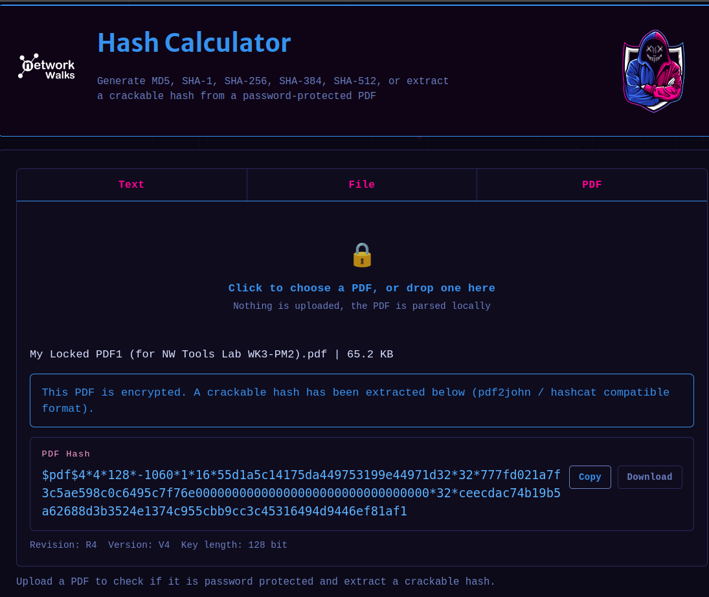
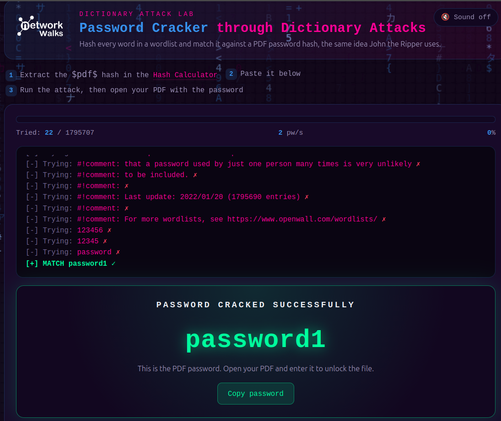
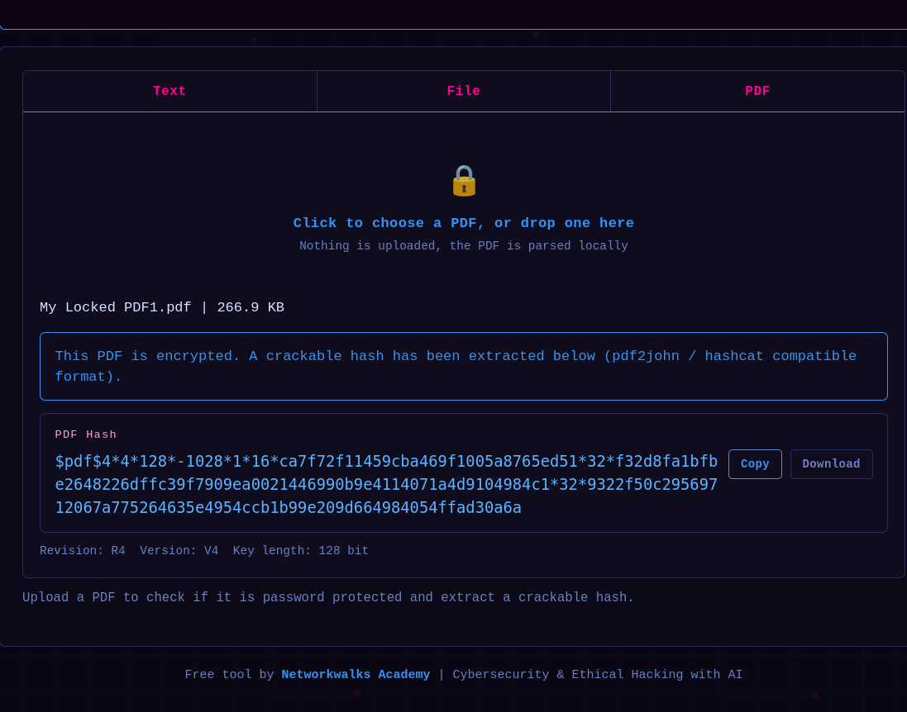
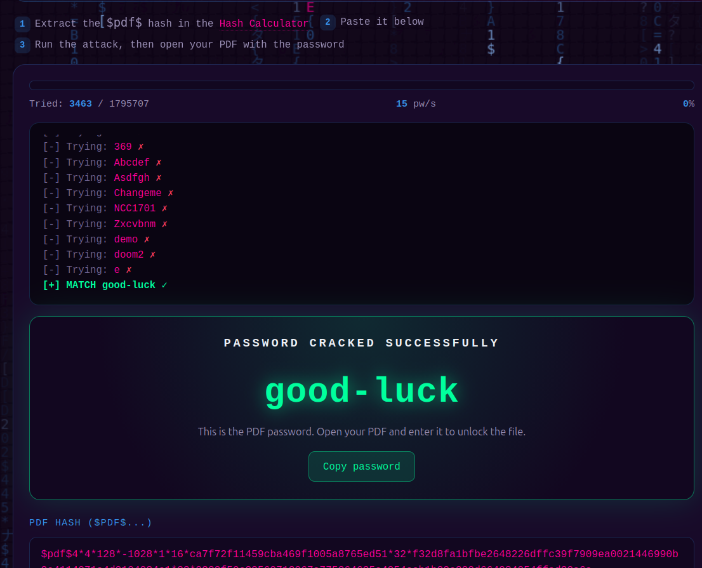

# Week 3 – Module 2: Password Cracking with NetworkWalks Tools

**Internship:** NetworkWalks-Cybersecurity
**Intern:** [Awais Sajjad]
**Week:** 3

> Performed for educational purposes only, on password-protected PDF
> files provided for this lab exercise.

## Background
This lab uses two free browser-based tools built by NetworkWalks: the
**Hash Calculator** (extracts a crackable hash from a locked PDF) and the
**Password Cracker** (runs a dictionary attack against that hash) —
no installation required, using the same underlying idea as John the
Ripper.

## Objective
Crack the password of the dedicated lab file for this module, and
additionally verify the approach against the same PDFs used in Module 1.

## Environment Used
Browser-based — works identically on Windows or Kali Linux since both
tools run entirely client-side.

---

## Primary Task: My Locked PDF1 (for NW Tools Lab WK3-PM2).pdf

**Step 1 — Extract hash:**
Uploaded `My Locked PDF1 (for NW Tools Lab WK3-PM2).pdf` (65.2 KB) to the
Hash Calculator, which extracted a crackable `$pdf$...` hash (128-bit,
Revision R4/V4).

**Step 2 — Run the Password Cracker:**
Pasted the hash into the Password Cracker and ran the dictionary attack.

**Cracked password:** `password1`

**Step 3 — Verify by opening the PDF:**
Opened the file and entered `password1` to unlock it, confirming
successful recovery and capturing the module-specific flag.

**Flag captured:** `nw{networkwalks_flag1_jtr_270521_1}`

---

## Additional Verification: Module 1 PDFs

To confirm the NetworkWalks tools produce identical results to JTR, the
same three PDFs from Module 1 were also run through the Hash Calculator
and Password Cracker:

| # | PDF File | Attempts Needed | Cracked Password |
|---|----------|---------------------|-----------------------|
| 1 | My Locked PDF1.pdf | 3,463 / 1,795,707 | `good-luck` |
| 2 | My Locked PDF2.pdf | 22 / 1,795,707 | `password1` |
| 3 | My Locked PDF3.pdf | 2,085 / 1,795,707 | `1qaz2wsx` |

**Screenshots:**

---

## Findings
The dedicated lab file's password (`password1`) was recovered quickly
since it sits early in the wordlist — confirming the result obtained in
Module 1 using JTR for the same password pattern. Running the same
three Module 1 PDFs through this browser tool produced **identical
cracked passwords** to JTR, validating that both approaches (local JTR
vs. browser-based NetworkWalks tools) implement the same dictionary
attack logic and reach the same result.

## Comparison with Module 1 (JTR)
| Criteria | JTR (Johnny, Module 1) | NetworkWalks Tools (Module 2) |
|----------|---------------------------|-----------------------------------|
| Installation required | Johnny GUI + John binary | None — runs in browser |
| Dedicated lab file password | — | `password1` |
| Shared PDFs' passwords | good-luck, password1, 1qaz2wsx | good-luck, password1, 1qaz2wsx (identical) |
| Processing location | Local on device | Local in-browser (PDF never uploaded) |
| Wordlist size | John's default jumbo wordlist | 1,795,707-word list |
| Speed shown | 100% cracked, time not displayed | Live attempts/sec shown (e.g. 15 pw/s) |

## Summary
Both the dedicated NW Tools lab file and the reused Module 1 PDFs were
cracked successfully, with results matching JTR exactly. This confirms
the NetworkWalks Hash Calculator and Password Cracker are a reliable,
installation-free alternative to John the Ripper for this type of
password recovery exercise.

## Key Takeaway
Regardless of which tool is used — professional (JTR) or
browser-based (NetworkWalks Tools) — a password's real strength is
determined by how predictable it is, not by which cracking tool is used
against it. Passwords that resemble dictionary words, common phrases, or
keyboard-walk patterns remain highly vulnerable either way.
